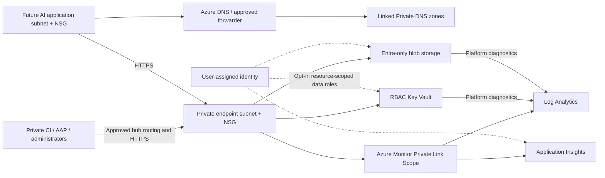
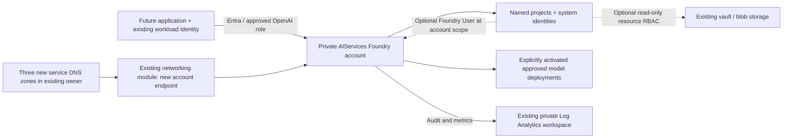

# Azure AI architecture and operating boundaries — Phases 1 and 2

## Foundation topology

One resource group per environment contains the foundation. Region, naming, tags, DNS and IP ranges are supplied inputs. Required tags are owner, cost center, data classification and application; environment and Terraform ownership are imposed by the composition. Region input is checked against an explicit approved set; that set must itself be approved by the organization.

Networking denies default VNet east-west access and Internet egress with priority-4096 rules. Workloads can resolve DNS and reach endpoint-subnet HTTPS. Approved trusted source ranges can reach workload and endpoint HTTPS. Return traffic is stateful. NSG policies are enabled on the endpoint subnet; default outbound access is disabled on both subnets. Hub routes, firewall inspection, peers, Azure DNS Private Resolver and VNet flow logging belong to the existing landing zone. Do not enable broad outbound access to satisfy a future dependency; add a reviewed rule and inspected route for that dependency.

Six private zones are linked: Key Vault, blob, and the four additional Azure Monitor namespaces. AMPLS's zone group uses five zones including blob. Existing hub-wide zones should be imported or this module adapted for central ownership before deployment; duplicate split-horizon zones and multiple AMPLS scopes can interrupt telemetry for other workloads. AMPLS scoped-service associations are completed before the AMPLS endpoint is created. Zone ownership and Azure Monitor DNS impact require landing-zone review.

## Security, state and identities

Azure RBAC controls the management plane separately from NSGs/Private Link and data-plane RBAC. Key Vault uses Entra RBAC and no access policies or service bypass. Storage disallows shared keys, public objects, cross-tenant replication and local users, requires HTTPS/TLS 1.2 and enables infrastructure encryption. Azure-managed keys provide service encryption; customer-managed key implementation is pending the organization's cryptographic requirements.

The workload identity starts with no grants. The optional three grants permit secret reads, blob reads and Entra-authenticated telemetry publication. They do not confer Azure management rights. Additional existing human/service principal IDs can be passed to the identity module with reviewed data/monitoring roles. Deployment identity privileges must be resource-group scoped where possible, with separately controlled role-assignment authority. A broad subscription Contributor role is not a default requirement.

AzureRM automatic provider registration is disabled. A landing-zone administrator must register Microsoft.Network, Microsoft.KeyVault, Microsoft.Storage, Microsoft.ManagedIdentity, Microsoft.Insights, Microsoft.OperationalInsights and applicable policy/authorization providers ahead of time. Subscription/RG creation and policy assignment permissions must be explicitly reviewed.

Remote state must pre-exist outside this stack and use Entra authentication, encryption, locks, private connectivity, retention and least-privilege Blob Data Contributor for the executor. Terraform plans and state can contain sensitive metadata and computed provider values even when outputs are marked sensitive. Never commit them. A state backend is not the application storage account this stack creates.

## Observability and recovery

Log Analytics uses at least 90-day retention, disabled public query/ingestion and disabled local authentication. Workspace-based Application Insights also disables public query/ingestion and local authentication. SDKs need the connection string plus Entra credential configuration; the string alone is insufficient. AMPLS is PrivateOnly for ingestion and queries. Key Vault audit, storage service transactions and blob read/write/delete logs are sent through platform diagnostic settings. Platform diagnostic transport is distinct from application traffic through the workload NSG. Diagnostic category names are documented service defaults, not confirmed against a deployed subscription.

No alert recipients, action groups, SLO queries, resource health alerts, budget limits, telemetry canaries, VNet flow logs or subscription activity-log export are configured without organizational inputs. These are deployment-readiness work items, not implemented controls. Landing-zone teams retain subscription activity/audit export ownership. Application teams must suppress prompt/response/secret content in telemetry and define redaction and retention before Phase 2.

ZRS is the default storage mode; the production example selects GZRS subject to region availability and approval. Regional durability is not application failover. Key Vault is platform-resilient within its service guarantees. This design has no secondary-region VNet, key/secret replication workflow, Foundry model deployment, gateway, compute or traffic failover. A DR deployment needs a second independent region/root/state and approved RPO/RTO, secret recovery, storage failover, model capacity, routing and recovery exercises. Do not claim end-to-end multi-region availability from this foundation.

## Responsibility and phase gates

| Component | Owns | Does not own |
|---|---|---|
| Azure Terraform foundation | Network, service resources, explicit RBAC, diagnostics, requested RG policy assignments | Identity directory administration, landing-zone policy exemptions, prompts/models/gateway governance |
| Foundry phase | Supported accounts, projects, model deployments and private connectivity | Gateway consumer subscriptions or API monetization |
| Gravitee phase | Supported API exposure, plans, subscriptions and gateway policies | Azure Private Link, Entra directory policy or Azure RBAC |
| Azure DevOps phase | PR validation, scans, artifacts and release approval | Duplicate execution alongside TFE/AAP |
| Chosen Terraform executor | Single plan/apply/state owner; pipeline or TFE | Imperative resource changes by post-deployment tools |
| AAP phase | Read-only validation, evidence, handover and optional ServiceNow integration | Editing Terraform-managed Azure or gateway resources |

Phase 1 local gate: initialization, schema validation, formatting and mocked tests for all deployment roots. Deployment gate: approved development credentials/state plus landing-zone readiness and an inspected real plan, followed by explicit apply approval. Phase 2 source is now implemented and locally tested as described below; no cloud deployment has been used to validate either phase. Gateway implementation remains pending Phase 3.

## Phase 2 — current Foundry account/project integration

The implementation uses Microsoft.CognitiveServices/accounts with kind AIServices and project management enabled, plus child accounts/projects and account model deployments. It does not create the older Microsoft.MachineLearningServices hub/project architecture. Terraform/AzureRM pins and locks remain unchanged; schema support is already present in AzureRM 5.13.0.

A null Foundry configuration preserves the original foundation topology. Enabled configurations add one account endpoint and zones for Cognitive Services, OpenAI and services.ai.azure.com. The same account private connection serves project endpoints; their URL maps come directly from the provider/service. Existing endpoint-subnet HTTPS rules apply without broadening egress or creating duplicate DNS owners. Private Link and account outbound restrictions do not configure standard-agent network injection or service-to-vault/storage connectivity.

All model catalogs and deployment requests are empty by default, as are all Foundry grants. Project identity runtime access to account capabilities requires an explicit Foundry User opt-in. Humans receive only explicitly requested project-scoped grants. The existing application identity can receive the fixed account-scoped OpenAI User role; it is not attached to a compute host by this stack. No generic role allowlist is widened.

Catalog selection pins format/name/version and checks region, SKU and a per-deployment capacity ceiling. NoAutoUpgrade prevents automatic model-version selection, but cannot prevent service retirement or establish availability/entitlement. Global/data-zone SKUs require explicit processing-boundary approval. Models on other inference contracts do not inherit an assumed OpenAI URL or SDK/API version.

The account's Audit/AllMetrics diagnostics reuse the existing monitor module/workspace. RequestResponse, Trace and allLogs are not enabled. Content/metadata redaction, retention and live category verification remain governance/runtime gates. No unsupported account-level Application Insights property or automatic agent/application telemetry integration is invented.

Service-managed encryption is implemented. Customer-managed keys, feature-specific connections/runtime state, recovery, advanced tools/agents and multiregion application failover remain explicit exclusions. See docs/phase2 for provider/API evidence, organizational inputs, security checks, deployment handoff and validation limits. The original Phase 1 sections above remain the foundation design; this section adds resources without claiming deployment readiness.
