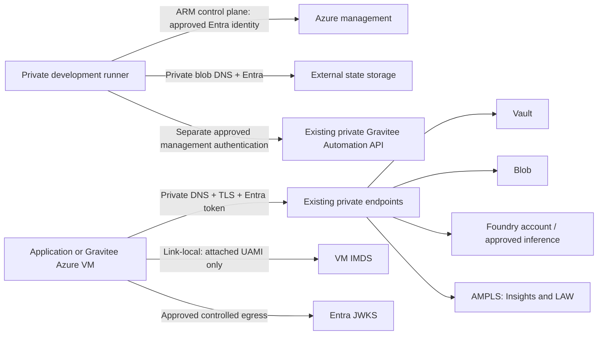

# Private access and identity change review

This change makes no deployment. Read [DEPENDENCIES.md](DEPENDENCIES.md) for the complete matrix, exceptions and missing inputs. The environment is not certified fully private or managed-identity-only.

## Architecture and ownership



Networking owns the PE subnet, endpoint groups, DNS zones and VNet links. Security owns vault/blob. Monitoring owns LAW/Insights/AMPLS and scoped services. Foundry owns account/projects and explicit model/RBAC configuration. Gateway roots configure an existing platform in separate state. No new host, endpoint, zone, role or Azure provider is created by default by this change. External state, VM attachment, DNS forwarders, firewall, counter store and management authentication remain external owners.

## Least-privilege workload configuration

In the selected Azure root's protected variable file, keep the legacy flag false and select only necessary permissions, for example:

```hcl
# Illustrative permission selection; it does not authorize deployment.
grant_workload_data_access = false
workload_data_access = {
  key_vault_secret_read = false
  storage_blob_read     = true
  telemetry_publish     = false
}
```

All new fields default false. Existing `grant_workload_data_access=true` remains compatible and grants all three privileges regardless of the new object. To narrow an existing deployment, explicitly set it false and select the required new permissions. Existing `secrets`, `blobs`, `telemetry` assignment keys/scopes/role names/principal behavior are retained. A real plan must confirm only intended assignments are removed or retained; do not assume no live changes from mocked checks. `workload_access_grants` is nonsecret review metadata, not proof of successful authentication.

`foundry_grant_workload_openai_access` remains independent and false by default. Project data grants are also independent. No automatic reading of Key Vault secrets or generating tokens occurs in Terraform.

## Gravitee activation contract

The unchanged runtime policy uses fixed VM IMDS, explicit UAMI client ID and the Cognitive Services token audience. Activated callers must now explicitly supply:

```hcl
# Fields inside the existing full reviewed platform object, not a complete tfvars.
hosting_model          = "azure_vm"
backend_rbac_confirmed = true
```

Set confirmations only after the VM owner verifies attachment of the selected identity, account-scoped OpenAI User permission, DNS/routing/TLS and IMDS/SSRF isolation. Review flags do not grant permission or probe the target. Missing hosting selection, AKS, App Service and Gravitee Cloud are rejected; no key/secret fallback is added. Existing positive test flags are synthetic. Disabled roots require none of these inputs and remain safe.

No runtime token cache was added. Per-request IMDS latency, concurrency, token confidentiality and failure behavior require target testing. Management API authentication remains a separate vendor capability: provider 1.2.0 does not establish MI login. If all management access must also use MI, this is a deployment blocker rather than permission to use an undocumented flow.

## State and runner prerequisites

Backend examples remain inactive unless deliberately copied into a root after independent bootstrap approval. For an existing private state account, use Entra blob authorization (`use_azuread_auth=true`) and one reviewed runner mechanism: `use_msi=true` for compatible Azure-hosted managed identity, or `use_oidc=true` for CI federation. Configure identity selection through protected environment/backend configuration; do not place secret values or tokens in configuration or chat. OIDC is not VM IMDS. Do not combine mechanisms without provider/backend documentation for the actual runner.

State needs its own blob PE, private DNS, disabled public/shared-key access, runner route and state-container Blob Data Contributor grant. The application blob account is not automatically the state backend. Bootstrap and assignment ownership must avoid a dependency cycle with the state being created. No state migration, real backend init or state inspection was performed.

## Network and runtime checks before any separately authorized deployment

1. Obtain actual subnet, private runner, DNS forwarder, hub/peering/VPN/ExpressRoute and firewall ownership. Existing root NSGs permit intended endpoint HTTPS/DNS and deny general outbound; they do not implement required JWKS/management/package egress. Do not add a broad Internet bypass. Specify the reviewed egress path with its owner before activation.
2. Verify service FQDNs resolve to approved private addresses from every caller, including on-premises runners. Test normal hostnames with valid TLS, not direct PE IP URLs. Validate NSGs/UDRs/peering and overlapping-address risks. A DNS zone link only covers its linked VNet; remote clients need forwarding and routing.
3. Verify UAMI client/principal/resource IDs are not confused, actual VM attachment, resource scopes, tenant, token audience and SDK TokenCredential configuration. RBAC changes can take time; test with bounded retries without enabling keys or public access. Cross-tenant identity designs need separate review.
4. For Foundry, approve model region/version/SKU/capacity/quota and the precise account/project operation. Project identities plus roles do not configure private managed-agent egress or tool connections. Those features remain excluded.
5. Verify Insights SDK Entra ingestion and LAW query independently; test AMPLS DNS/PrivateOnly behavior. If AMA/custom logs are needed, first design DCR/DCE support. Verify diagnostic categories and actual platform delivery independently of client ingestion.
6. Review an approved development plan and resource lifecycle effects. Any provisioning/publication needs separate authorization. No production secrets or infrastructure are needed for local validation.

Local checks use `terraform init -backend=false -input=false -lockfile=readonly`, `validate`, mocked `test`, and the policy checker. See [VALIDATION.md](VALIDATION.md). Do not run the example backend against live state as part of these checks.

## Operations and rollback

This is a source-only, no-new-default-resource change. Resource addresses, providers, locks and existing controls are retained. Gateway activation inputs are intentionally stricter; existing enabled configuration must provide actual hosting/RBAC review before planning. Missing DNS ownership fails earlier rather than producing an invalid index.

Before a later authorized rollout, capture a reviewed plan, ownership and recovery procedure; plan for DNS cache/TTL, RBAC propagation, private-runner availability, IMDS dependency, counter-store reliability and loss of emergency public access. Manage state backups/versioning and access externally. Existing vault/blob retention is not a tested disaster-recovery solution; no regional failover or new DR is implemented.

Source rollback can revert this commit on a reviewed branch. Reverting source does not roll back deployed RBAC/network changes; inspect a fresh development plan and restore only approved prior permissions. Do not re-enable public/key access as a troubleshooting shortcut. Narrowing the legacy grant can remove permissions and interrupt an application if its requirements were not inventoried.

Private endpoints, private DNS, peering/transport, ingestion/retention and model/gateway runtime all have costs. This change adds no cost estimate or capacity entitlement. Data residency depends on selected regions, storage replication and model deployment SKU; telemetry destinations/retention and vendor management/licensing must be reviewed separately. No unimplemented recovery, retention or residency guarantee is asserted.
